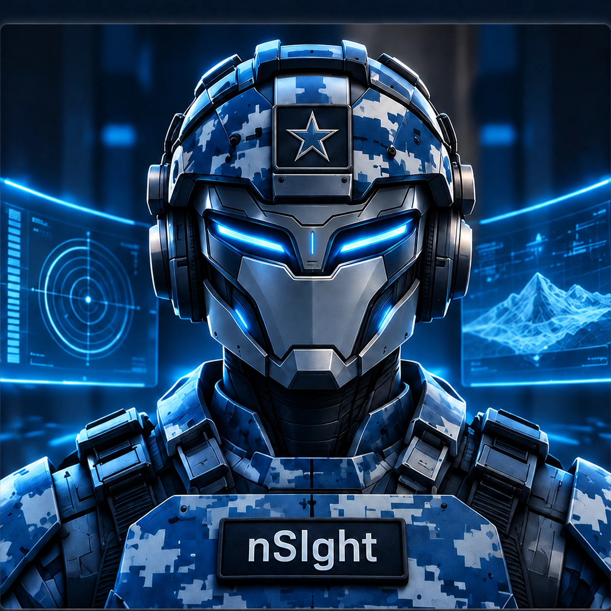

# nSIght — Mission EdgeSight Local AI (macOS)

A source-ready macOS nSIght application for Mission EdgeSight. The interface talks to **your configured local Qwen3 4B OpenAI-compatible Chat Completions endpoint**, and can use explicitly approved **read-only EdgeSight MCP tools** through authenticated Streamable HTTP. There is no OpenAI cloud dependency.

**Delivery status:** Complete source project; macOS binary **not** compiled here. It must be built on macOS with Xcode Command Line Tools, Node.js and Rust. Qwen/MCP live endpoint behavior has not been verified against your environment.



## Version 0.2.0 branding

Visible title: **MISSION EDGESIGHT / LOCAL AI** → **nSIght**. Under the portrait: **TACTICAL INTELLIGENCE · EDGE ANALYSIS**. Removed the former extra product wording and start-screen status tagline. The original miniature floating option remains available as a compact view.

**Upgrade note:** The Tauri bundle identifier `com.nightpet` and Keychain service ID are deliberately unchanged so existing saved settings and credentials can remain available when upgrading. The on-screen app name and bundled app product are **nSIght**. Do not change the bundle identifier without a settings/Keychain migration plan.

## Visual preview

The included `tests/preview-static.html` is a **visual-only mockup**, not a live transcript or verified mission data. The application will show real data only after model and MCP configuration.

## Features implemented

- Transparent, borderless, always-on-top desktop window; drag from six-dot handle.
- Compact view (170 × 180) and expanded Chat mode (420 × 650). Click compact avatar to expand.
- nSIght military-analyst avatar, idle animation, Qwen-thinking glow, and connection indicators.
- Multi-turn text chat with the configured Qwen3 model (limited conversation history in memory).
- Native Rust proxy for network requests: no MCP bearer or Qwen key appears in the browser URL or local storage.
- macOS Keychain storage for Qwen and MCP bearer credentials.
- MCP initialize / initialized / tools/list / tools/call over Streamable HTTP, including JSON responses, response-scoped SSE events and legacy session headers.
- Discover MCP tools; approve eligible, inspected read-only tools explicitly. No tool is enabled by default.
- OpenAI-compatible `tools` / `tool_calls` round-tripping to Qwen3 and tool-result replay, with call and output limits.
- Plain text Qwen still works when MCP is unreachable; an MCP warning is displayed.
- Settings saved in app config directory; credentials live in Keychain, not JSON.
- Security restrictions: no frontend remote fetch permission, no arbitrary shell, no tool execution unless approved, and an explicit denylist of mutation-oriented tool names.

## Build on macOS

Prerequisites:

1. Install Xcode Command Line Tools: `xcode-select --install`
2. Install Node.js 22+ and npm (`brew install node` works if you use Homebrew).
3. Install Rust stable with the official [rustup](https://rustup.rs/) and ensure `cargo` is on `PATH`.
4. Unzip the project and open Terminal in the `nsight-macos` directory.

Development launch:

```bash
./scripts/run-dev-macos.sh
```

Build an unsigned `.app` and `.dmg`:

```bash
./scripts/build-macos.sh
```

Expected output:

- `src-tauri/target/release/bundle/macos/nSIght.app`
- `src-tauri/target/release/bundle/dmg/…dmg`

Tauri bundles are built for the **host Mac architecture**. For Apple Silicon run on an Apple Silicon Mac; for Intel run on an Intel Mac or set up explicit cross-compilation. Distribution to other Macs requires code signing and notarization, which is not configured in this Phase 1 project. If macOS Gatekeeper blocks the unsigned app, run it via `npm run tauri dev` while developing rather than disabling system-wide security.

## First-run configuration

Open the gear icon in the expanded app. All requests are issued by the Rust backend. **Save before testing** (Test buttons use the last saved settings, not unsaved edits).

### Local Qwen3 4B

Set **OpenAI-compatible Chat Completions URL** to the real URL of the model your existing nSIght Console uses.

Examples (these are illustrations, not verified addresses in your network):

| Serving approach | Example Chat Completions URL | Example model name |
|---|---|---|
| Ollama running on the same Mac | `http://127.0.0.1:11434/v1/chat/completions` | `qwen3:4b` |
| Ollama on a Jetson reachable over the LAN | `http://10.1.103.130:11434/v1/chat/completions` | `qwen3:4b` |
| Your existing nSIght local model gateway | `https://YOUR-HOST/v1/chat/completions` | exact model ID reported by that server |

**Important:** Ollama and other model servers must actually be listening on the specified host and path. A model shown in the Console as “LOCAL QWEN3 4B” does **not** prove it exposes an OpenAI-compatible API to the Mac. If it uses a different native API, add an adapter to your gateway or adjust `src-tauri/src/qwen.rs`.

The Qwen HTTP endpoint must support `/v1/chat/completions`, `stream:false`, `choices[0].message.content` and, for MCP-assisted Q&A, OpenAI-style function/tool calling. A Qwen deployment without tool-calling support can still do ordinary text chat. Configure an optional bearer token if your model gateway requires one.

### EdgeSight MCP

The project is prefilled with the **previously used** EdgeSight endpoint:

```
https://YOUR_MISSION_EDGESIGHT_URL.com/mcp
```

This is only a configuration default; **connectivity has not been verified**. Paste the MCP bearer token into Settings and save. The token is not bundled in the project. Test MCP, then click **Discover tools**. Review the descriptions and select only tools you have confirmed cannot change mission, sensor, pod or Kubernetes state. Save again.

The MCP protocol version defaults to `2025-06-18`; older and newer versions can be selected in Settings. Streamable HTTP JSON and request-bound SSE are implemented, including session headers for 2025-compatible servers. The newly revised 2026-07-28 transport has metadata/header requirements not implemented in this Phase 1 client, so it is not selectable. Use 2025-06-18 or the version your existing server supports.

### Tool permissions

Tool calls require BOTH:

1. Explicit tool-name selection in Settings, which is saved to local app configuration.
2. A conservative read-only eligibility filter: recognized retrieval names or MCP `annotations.readOnlyHint:true` AND no obvious write/control verbs or shell/SQL fields.

No tools are enabled by default. This is a *defense-in-depth heuristic*, not a provable capability sandbox. The server must still enforce read-only authorization for the nSIght app token; do not give the app a token that can alter edge services. Prompts and returned tool data are untrusted and may contain instructions that Qwen could mishandle.

**Recommended production change:** Issue a distinct EdgeSight MCP token scoped to a server-enforced read-only role with a static tool allowlist. Avoid using an existing high-privilege admin token.

## How the program works

```text
macOS nSIght app window
   └── Tauri `invoke` commands (no frontend network access)
       ├── Qwen Chat Completions REST API
       ├── EdgeSight MCP Streamable HTTP
       ├── macOS Keychain (bearer tokens)
       └── app config JSON (nonsecret URLs, model and tool allowlist)
```

In chat, Rust loads the configured MCP connection, resolves explicitly allowed tools, translates their JSON schemas into OpenAI function definitions, asks Qwen, invokes the approved tool calls, and sends tool results back to Qwen until it can answer. For ordinary conversation, it uses Qwen without needing MCP.

## Troubleshooting

| Symptom | Check |
|---|---|
| Qwen test fails with connection refused | Is the model server actually running and reachable from the Mac? Does the URL end in `/v1/chat/completions`? |
| HTTP 404 from Qwen | A non-OpenAI-compatible gateway URL was supplied, or the path is wrong. |
| Qwen answers but no mission details | Discover, approve, and **Save** read-only MCP tools, then inspect MCP Test. |
| MCP 401/403 | Confirm the token is valid and has authorization to list/call tools. |
| MCP fails initialization | Test alternate protocol version, ensure Streamable HTTP POST support. |
| Qwen fails function/tool calls | Confirm this model runtime supports OpenAI-compatible `tools` / `tool_calls`. |
| Blank avatar | Confirm `public/nsight-avatar.webp` exists; restart Tauri if an older image is cached. |
| App does not appear above another app | macOS Spaces or full-screen windows may affect always-on-top behavior; use a normal desktop Space. |

## Privacy and limitations

- No ChatGPT, OpenAI API or cloud processing is required **if the URLs you configure resolve only to your own local/LAN services**. The included default MCP URL is a publicly addressable hostname, so requests to it may traverse your network, VPN, or Internet; whether it remains local depends on your routing and DNS.
- No voice, speech synthesis, push alerts, tray menu, persistent conversation log, diagnostics polling, or mission control yet. Those are Phase 2+.
- Qwen responses are non-streaming in Phase 1; a thinking animation is displayed while awaiting the reply.
- MCP transport supports JSON-RPC JSON and response-scoped SSE, but not the older separate HTTP+SSE transport, remote event subscriptions, MRTR, OAuth login flow, or the full 2026-07-28 metadata extension.
- The corrected steel-faced nSIght image is included in **both** `public/nsight-avatar-source.png` and `public/nsight-avatar.webp`; `public/nsight-avatar.png` is a second PNG copy for convenience. The icon images are derived from the same portrait.
- Unsigned, unnotarized source project; Mac `.app` binary cannot be produced on the Linux authoring environment and has **not** been compiled or tested on macOS.

## Source map

- `src/App.tsx` — chat UI, draggable window, connection settings, tool approval.
- `src/styles.css` — visual design and animations.
- `src-tauri/src/config.rs` — saved nonsecret configuration, Keychain credentials and URL checks.
- `src-tauri/src/mcp.rs` — MCP HTTP JSON-RPC protocol, tool discovery and read-only filter.
- `src-tauri/src/qwen.rs` — model chat client and tool-call orchestration.
- `src-tauri/src/lib.rs` — Tauri commands and HTTP client.
- `scripts/` — Mac developer launch and build.

For additional info:

- [Tauri 2](https://v2.tauri.app/)
- [MCP Streamable HTTP 2025-11-25](https://modelcontextprotocol.io/specification/2025-11-25/basic/transports)
- [Ollama OpenAI compatibility](https://docs.ollama.com/api/openai-compatibility)
